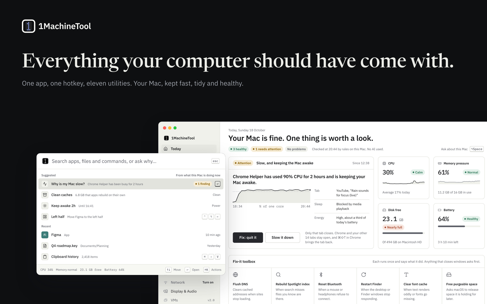
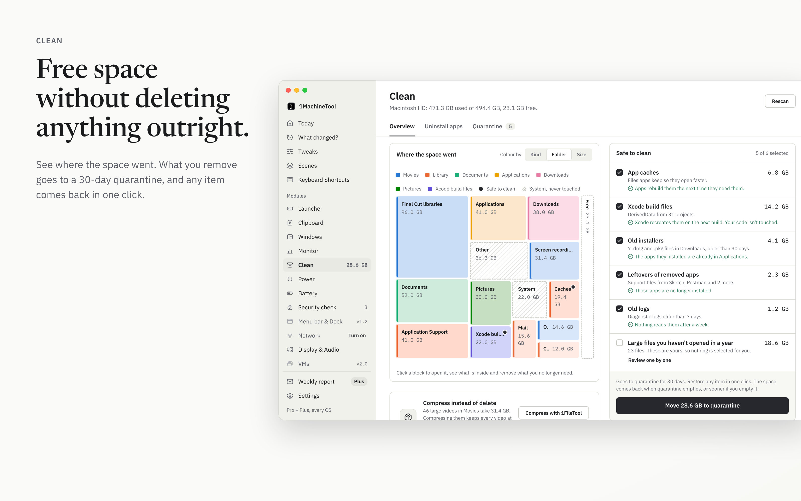
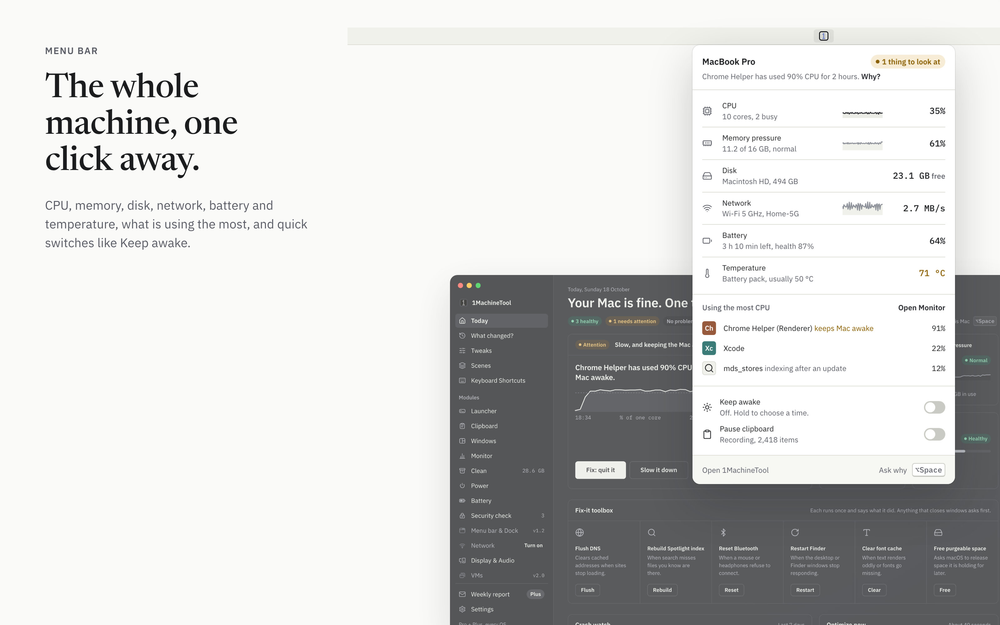

# 1MachineTool

**Everything your computer should have come with: one app, one hotkey, eleven
utilities.**

1MachineTool keeps your Mac fast, tidy and healthy. Ask it why the Mac is slow,
hot, full or draining, and it answers in one sentence, shows the evidence, and
offers the fix. The launcher, clipboard history, window snapping, monitor,
cleaner, power and battery tools and a security check all live in one small
app behind one hotkey.

- **Explains before it acts.** Every finding says what is happening, the
  evidence for it, and what changes if you fix it. Diagnosis runs on rules on
  your Mac; no AI is involved unless you turn it on and choose the provider.
- **Never deletes outright.** Anything Clean removes goes to a 30-day
  quarantine first, and any item comes back in one click.
- **Bought once.** A one-time Pro license, no subscription required. Everything
  runs locally.

## Downloads

Grab the newest installer from
[**Releases**](https://github.com/stoicsoft/1machinetool-releases/releases/latest).

| Platform | File | Status |
|---|---|---|
| macOS (Apple Silicon) | `.dmg` — `aarch64` | Available |
| macOS (Intel) | — | Later |
| Windows | — | Planned for v1.1 |
| Linux | — | Planned for v1.3 |

## What it looks like

**Your Mac, in one sentence.** Today opens with a verdict, the one thing worth a
look, the readings behind it, and a fix-it toolbox.

**Ask why, get an answer.** Press ⌥Space, type "why is my mac slow", and the
launcher checks six things and explains what it found, with Quit it, Slow it
down and Ignore right there.

**See what your Mac has been doing.** CPU, memory, energy, network, battery and
temperature, read every 30 seconds and kept for 30 days.

**Free space without deleting anything outright.** See where the space went,
pick what is safe to clean, and send it to quarantine.

**The whole machine, one click away.** The menu bar panel shows every reading,
what is using the most, and quick switches like Keep awake.

## Updates

The app updates itself. Each published release carries a signed `latest.json`
manifest; 1MachineTool checks it, verifies the update's signature before
installing, and offers the new version in the app. Only published releases are
served — drafts are not.

## Issues

This repository carries the release artifacts; the source lives elsewhere. File
bugs and requests in
[Issues](https://github.com/stoicsoft/1machinetool-releases/issues).
